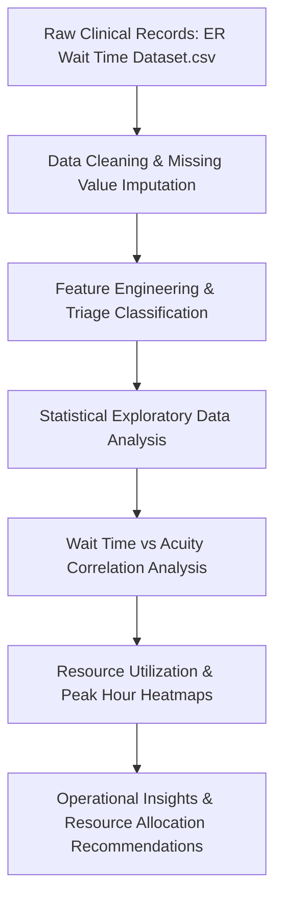

# Clinical Data Analytics Suite

## Overview
The Clinical Data Analytics Suite provides statistical evaluation, exploratory data analysis, and operational reporting on hospital emergency department patient flows and wait times. Designed for clinical operations analysts, the suite surfaces triage bottlenecks, patient volume surges, and physician resource allocation dynamics.

## System Architecture



## Core Features
- **Patient Flow Analysis**: Quantitative tracking of patient journey stages from triage intake to clinical consultation.
- **Triage Acuity Stratification**: Evaluation of emergency severity levels against standardized waiting thresholds.
- **Temporal Volume Decomposition**: Hourly, daily, and seasonal heatmaps isolating clinical surge intervals.
- **Statistical Significance Testing**: Hypothesis testing evaluating wait duration differentials across clinical departments.

## Repository Structure
```
clinical-data-analytics-suite/
|-- archive/
|   |-- ER Wait Time Data Overview.txt
|   +-- ER Wait Time Dataset.csv
|-- notebooks/
|   +-- ER.ipynb
|-- requirements.txt
+-- README.md
```

## Technology Stack
| Layer | Technologies |
| :--- | :--- |
| Core Language | Python 3.10+ |
| Data Processing | Pandas, NumPy |
| Visualization | Matplotlib, Seaborn, Plotly |
| Statistical Computing | SciPy, Statsmodels |
| Notebook Environment | JupyterLab |

## Installation & Execution
```bash
# Clone the repository
git clone https://github.com/sohailahmed-bsrh/clinical-data-analytics-suite.git
cd clinical-data-analytics-suite

# Install dependencies
pip install -r requirements.txt

# Launch exploratory analysis notebook
jupyter notebook notebooks/ER.ipynb
```

## License
Distributed under the MIT License.
